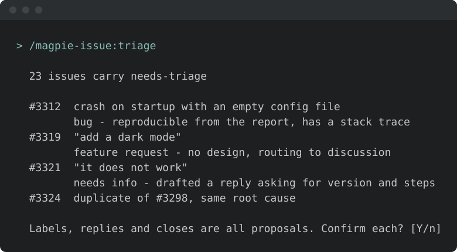
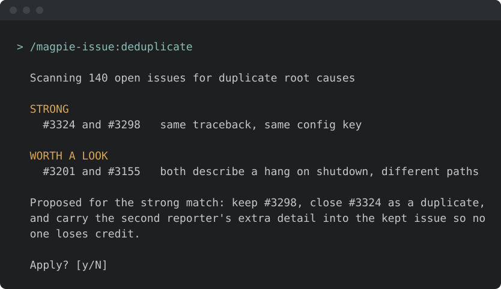
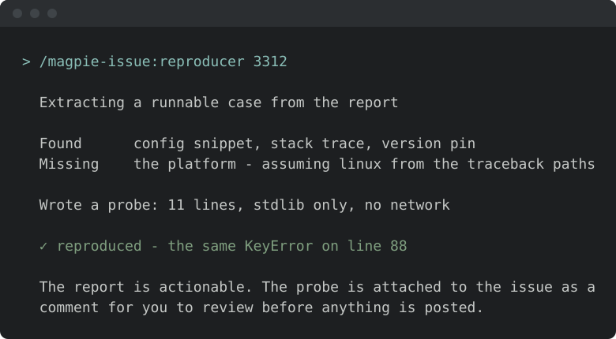

# Install & first runs

Rendered page: https://magpie.apache.org/docs/issue-management/install/

Source: https://github.com/apache/magpie/blob/main/docs/issue-management/install.md

<!-- SPDX-License-Identifier: Apache-2.0
     https://www.apache.org/licenses/LICENSE-2.0 -->

Install just this family — one plugin, 8 skills. General-issue lifecycle: triage, reproduction, dedup, backlog.

Once you have [added the marketplace](/docs/setup/marketplace-install):

```text
/plugin install magpie-issue@apache-magpie
```

New to Magpie? The [quick start](/docs/quick-start) walks the whole path in
one place — install, the first `/magpie-setup:setup` run, and a recording of it
happening — plus the other agents and the secure-isolation setup to run next.

The first issue skill you run opens with a one-minute
[welcome guide](https://github.com/apache/magpie/blob/main/plugins/magpie-setup/skills/setup/setup_preflight/guides/issue.md):
the typical flow, what needs configuring, what to ask it, and how to make it yours.
Dismiss it, or hide it for good, from its last line;
*"show the issue welcome again"* or `/magpie-setup:welcome-guide issue` brings it back.

## Before the first run

<!-- BEGIN generated: skill-config (tools/dev/check-skill-config.py --fix) -->


*Illustrative — the real run derives more and asks better. What is true is
the shape: it runs itself, it writes only your personal layer, and it
stages nothing.*

Every skill here resolves project-specific values from the adopter's
[`<project-config>/`](https://github.com/apache/magpie/tree/main/plugins/magpie-setup/templates) directory — which is
your personal layer first — `.apache-magpie-local/` (gitignored) in a
project that adopted Magpie, `<git-common-dir>/apache-magpie/` in one
that did not — then `.apache-magpie-overrides/` (committed, the project's).

**For yourself:** `/magpie-setup:setup config` scaffolds and fills these locally
(`/magpie-setup config` on a [pinned-snapshot install](/docs/setup/marketplace#skill-names-differ-by-install-method)).
Nothing is staged, nothing is committed, and it works on a repository that
has never adopted Magpie.

**For the project:** [`/magpie-setup:setup adopt`](/docs/setup/team-adoption)
commits them for every contributor, either scaffolded directly or promoted
from what you configured locally.

**Required.** Without these a skill would act on a guess, so it stops and
says which file is missing.

| File | What it carries | Read by |
|---|---|---|
| [`fix-workflow.md`](https://github.com/apache/magpie/blob/main/plugins/magpie-setup/templates/fix-workflow.md) | Fork / clone / toolchain specifics, backport-label policy, commit-trailer wording, PR scrubbing, private-PR fallback. | `fix-workflow` |
| [`issue-tracker-config.md`](https://github.com/apache/magpie/blob/main/plugins/magpie-setup/templates/issue-tracker-config.md) | Tracker URL, project key, auth model, default query templates. | `backlog-stats`, `deduplicate`, `reassess`, `reassess-stats`, `reproducer`, `stale-sweep`, `triage` |
| [`project.md`](https://github.com/apache/magpie/blob/main/plugins/magpie-setup/templates/project.md) | Project manifest. Identity, repositories, mailing lists, tools enabled, CVE tooling, GitHub project-board + issue-template field declarations. The single file every skill reads to resolve project-scoped references. | `stale-sweep`, `triage` |
| [`reassess-pool-defaults.md`](https://github.com/apache/magpie/blob/main/plugins/magpie-setup/templates/reassess-pool-defaults.md) | Named pools for reassessment sweeps (`open-eol`, `reopened`, `stale-unresolved`, project-specific). | `reassess` |
| [`reproducer-conventions.md`](https://github.com/apache/magpie/blob/main/plugins/magpie-setup/templates/reproducer-conventions.md) | Evidence-package directory layout and frozen-copy discipline. | `reproducer` |
| [`runtime-invocation.md`](https://github.com/apache/magpie/blob/main/plugins/magpie-setup/templates/runtime-invocation.md) | Build prerequisite, run-a-single-file recipe, stream-capture conventions, network/dependency handling. | `fix-workflow`, `reproducer` |

**Optional.** Each has a documented fallback; absent, the skill still runs.

| File | What it carries | Read by |
|---|---|---|
| [`canned-responses.md`](https://github.com/apache/magpie/blob/main/plugins/magpie-setup/templates/canned-responses.md) | Reusable reporter-facing reply templates. | `triage` |
| [`release-trains.md`](https://github.com/apache/magpie/blob/main/plugins/magpie-setup/templates/release-trains.md) | Active release branches, release-manager attribution per cut, rotation rosters, security-team roster. | `triage` |
| [`scope-labels.md`](https://github.com/apache/magpie/blob/main/plugins/magpie-setup/templates/scope-labels.md) | Scope label → CVE product / `packageName` / collection-URL mapping. Exactly one scope label per tracker. | `backlog-stats`, `reassess`, `triage` |
| [`stale-sweep-config.md`](https://github.com/apache/magpie/blob/main/plugins/magpie-setup/templates/stale-sweep-config.md) | Grace windows and exemption labels for stale sweeps. Absent, the framework defaults apply. | `backlog-stats`, `stale-sweep` |

<!-- END generated: skill-config -->

## Try these first

*Illustrative shapes, not real transcripts — your output will differ. Nothing
below sends, merges, or posts anything without you confirming it.*

**Triage the new issues.**

```text
/magpie-issue:triage
```



**Find the duplicates.**

```text
/magpie-issue:deduplicate
```



**Try to reproduce one.**

```text
/magpie-issue:reproducer
```


